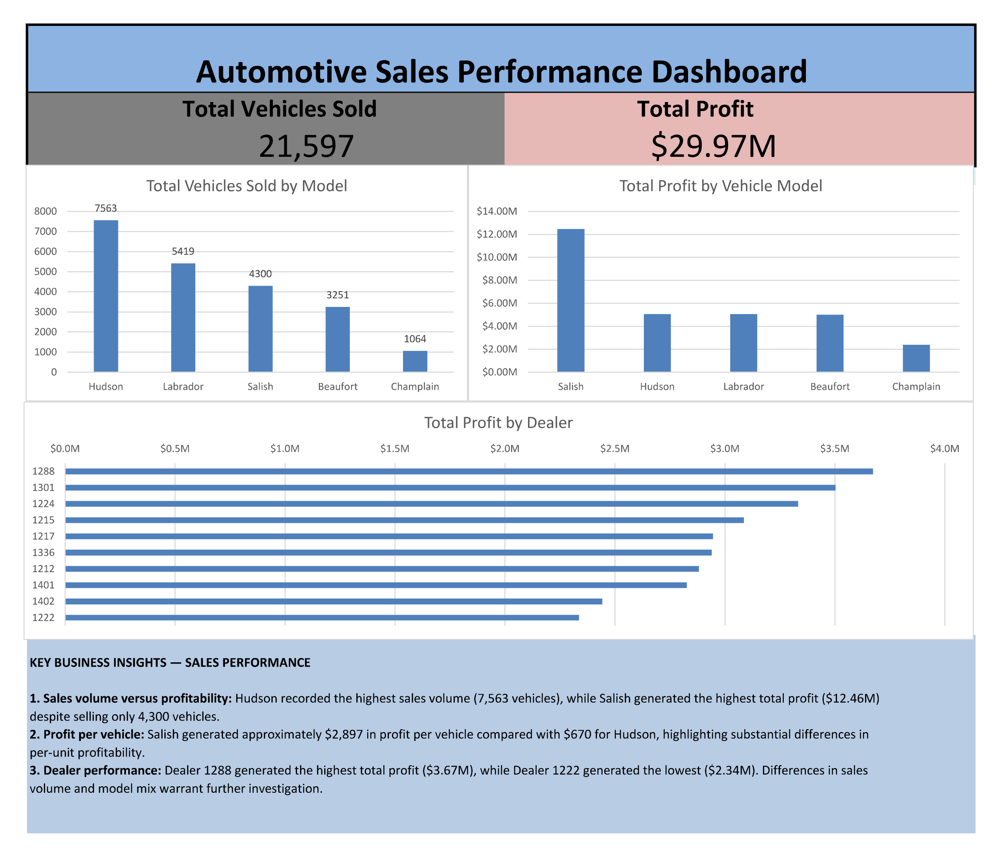
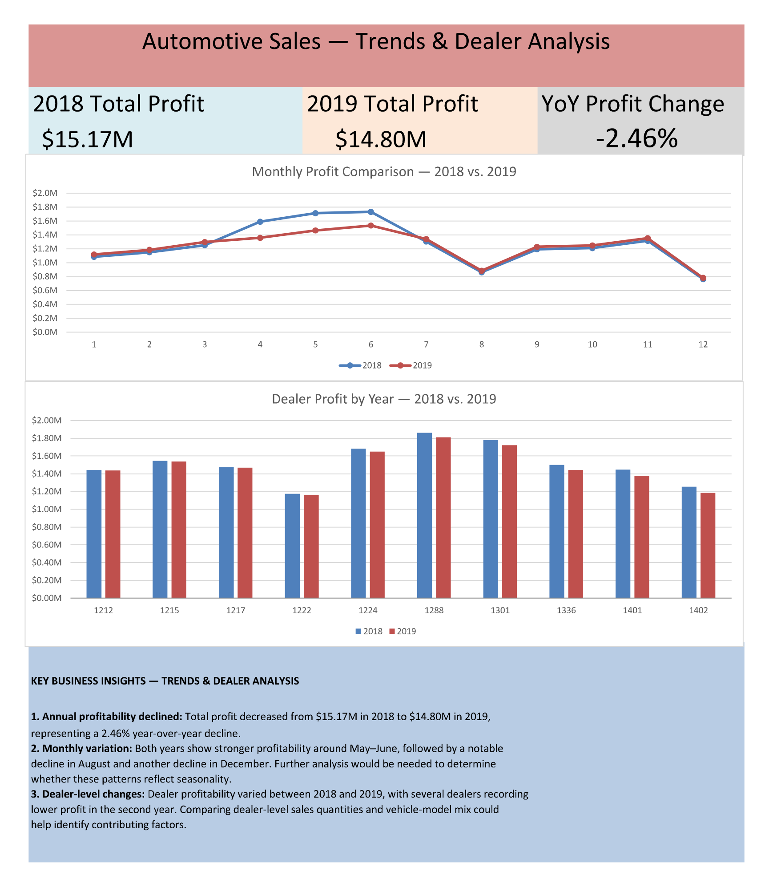

# Automotive Sales Analytics | Excel Dashboards

**Tools:** Microsoft Excel, PivotTables, PivotCharts, Excel formulas, KPI reporting, data validation  
**Period analysed:** 2018–2019  
**Project context:** Began as guided IBM/Coursera coursework; subsequently revised and extended with additional analysis, dashboards, validation, and business insights.

## Overview

This project analyses automotive dealership sales and profit by vehicle model, dealer, month, and year. The workbook includes a sales-performance dashboard, a trends-and-dealer-analysis dashboard, supporting PivotTables, and analysis notes.

## Business questions

- Which vehicle models lead in sales volume versus total profit?
- How does profitability compare across dealers and models?
- How did total profit and monthly trends change from 2018 to 2019?

## Dashboard 1 — Sales Performance

- **Total vehicles sold:** 21,597
- **Total profit:** $29,968,866.25
- Charts compare quantity sold by model, total profit by model, and total profit by dealer.

<!-- Add the final approved dashboard screenshot here, e.g.  -->

## Dashboard 2 — Trends & Dealer Analysis

- **2018 profit:** $15,171,128.75
- **2019 profit:** $14,797,737.50
- **Year-over-year change:** −2.46%
- Charts compare monthly profit between years and annual profit by dealer.

<!-- Add the final approved dashboard screenshot here, e.g.  -->

## Key findings

1. **Volume and profit leaders differ.** Hudson sold 7,563 vehicles, while Salish generated approximately $12.46M profit from 4,300 vehicles.
2. **Profit per vehicle differs substantially.** Salish generated about $2,897.23 profit per vehicle, versus about $669.68 for Hudson.
3. **Dealer performance varies.** Dealer 1288 generated about $3.67M profit, versus about $2.34M for Dealer 1222.
4. **Annual profit declined.** Total profit decreased 2.46% from 2018 to 2019.

## Analytical approach

- Summarised sales quantity and profit using PivotTables and charts.
- Computed profit per vehicle as total profit divided by total vehicles sold for each model.
- Compared annual profits using `(Profit_2019 - Profit_2018) / Profit_2018`.
- Added a Month Number field using `MONTH()` to sort month labels chronologically.
- Reconciled dashboard quantity and profit totals with `SUM` on source fields.
- Used `COUNTBLANK` on the seven original data columns; the checked ranges returned zero blanks.
- Used `COUNTIFS` to investigate repeated Year–Month–Model–Dealer ID combinations; none were reported in the checked range.

## Limitations

- These checks do not prove every record is valid; repeated combinations are not necessarily duplicates and missing-value checks do not detect every data-quality issue.
- Available fields cannot establish the causal reasons for differences in profitability, nor reveal selling prices, costs, marketing effects, or profit-margin percentages.
- The two dashboards summarise historical sample/course data and do not represent live business reporting.

## Learning Context and Data Attribution

This project originated from IBM's **Data Visualization and Dashboards with Excel and Cognos** course on Coursera.

I personally completed the original Excel charting, PivotTable, and dashboard exercises using the instructional videos and hands-on lab guidance.

I subsequently revisited the project and extended it through additional PivotTable analysis, two consolidated Excel dashboards, KPI calculations, data validation, year-over-year comparisons, and business interpretation.

This project represents guided coursework followed by additional hands-on analytical practice, rather than professional employment experience.

### Course and Dataset Sources

**IBM/Coursera Course:**

[Data Visualization and Dashboards with Excel and Cognos](https://www.coursera.org/learn/data-visualization-dashboards-excel-cognos)

**Excel Dataset:**

Automotive dealership sales dataset provided through IBM/Coursera Excel laboratory exercises.

**Original Automotive Sample Data:**

[IBM Accelerator Catalog — Automotive Industry Sample Data](https://accelerator.ca.analytics.ibm.com/bi/?perspective=authoring&pathRef=.public_folders%2FIBM%2BAccelerator%2BCatalog%2FContent%2FDAT00142&id=i22898C2A4DD748F79E0FC2BD017F4FE8&objRef=i22898C2A4DD748F79E0FC2BD017F4FE8&action=run&format=HTML)

IBM's Cognos assignment documentation identifies the Accelerator Catalog as the original source family and states that a modified subset of the sample data is used in the coursework.

The Excel dataset's exact correspondence to the original catalog download has not been independently verified.

### Project Contributions

**Guided IBM/Coursera exercises:** Created Excel visualizations and dashboards following course instructions.

**Additional portfolio work:** Expanded the analysis with independently practised PivotTables, consolidated dashboards, profit-per-vehicle metrics, monthly and annual profitability comparisons, reporting validation, and documented business insights.
## Files

The final workbook and dashboard images will be added after checking the course/data licence and confirming that the final exported files display correctly.
